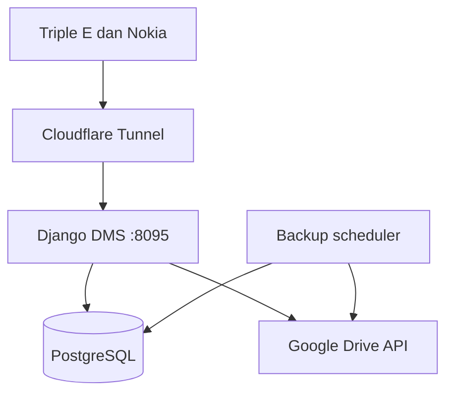
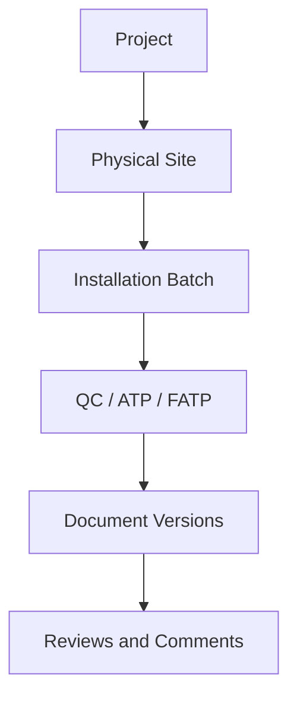
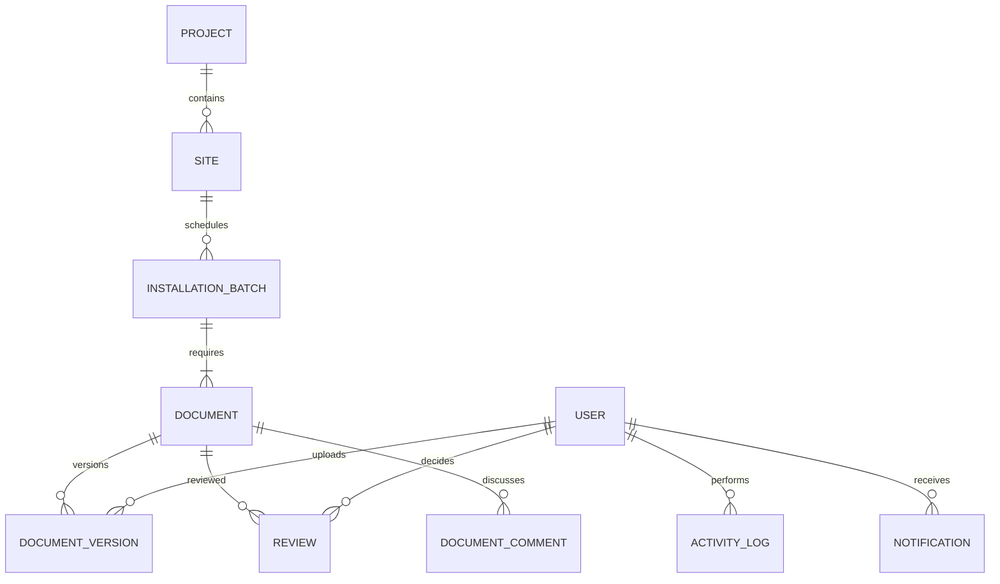
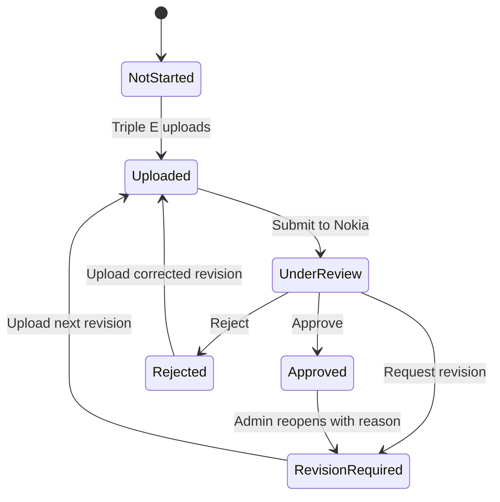

# Architecture Blueprint

## Topologi

Cloudflare mengarah ke `http://192.168.100.110:8095`. PostgreSQL hanya berada di private Docker network dan tidak memiliki host port.

## Hierarki data

Mentigi dan Sungai Liat masing-masing mempunyai satu physical site dan dua installation batches. Total awal adalah 16 physical sites, 18 batches, dan 54 document registers.

## Entity relationship

## Source of truth

| Informasi | Source of truth |
|---|---|
| Site, batch, status, role | PostgreSQL |
| Review, komentar, notifikasi | PostgreSQL |
| Audit upload/preview/download | PostgreSQL |
| File dokumen dan backup | Google Drive pribadi |
| File ID, checksum, revision number | PostgreSQL |

## Document state machine

Approved versions remain immutable. Reopening a document changes the register status but never deletes or overwrites the approved file.

## Role matrix

| Role | View/download | Upload/submit | Review decision | User admin | Reopen approved |
|---|:---:|:---:|:---:|:---:|:---:|
| Super Admin | Ya | Ya | Ya, emergency override | Semua role | Ya |
| Triple E Admin | Ya | Ya | Tidak | Selain Super Admin | Ya |
| Triple E Engineer | Ya | Ya | Tidak | Tidak | Tidak |
| Nokia Reviewer | Ya | Tidak | Approve/Revision/Reject | Tidak | Tidak |
| Nokia Viewer | Ya | Tidak | Tidak | Tidak | Tidak |

Semua role dapat menambahkan komentar. Nokia mengakses file melalui endpoint DMS terautentikasi dan tidak menerima public link atau izin langsung pada folder Google Drive.

## Security boundaries

- Google Drive uses OAuth scope `drive.file`.
- OAuth refresh tokens and database backups are encrypted using separate Fernet keys.
- No `Anyone with the link` sharing.
- Download and preview flow through the authenticated DMS.
- Database is not exposed outside Docker network.
- Login is locked for 15 minutes after five failed attempts.
- Secure cookies and CSRF protection are enabled behind Cloudflare HTTPS.
